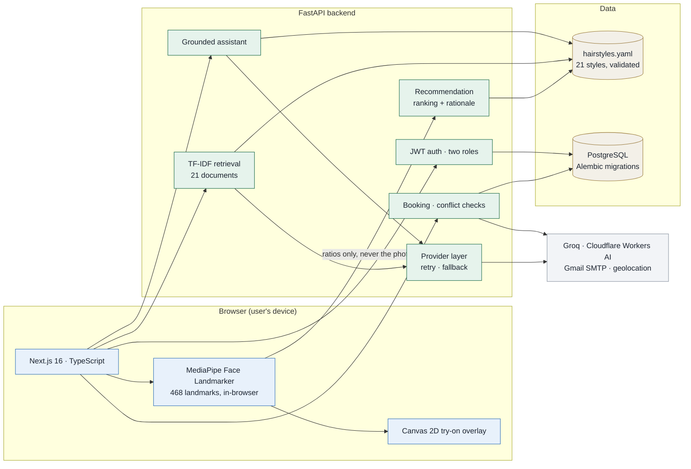
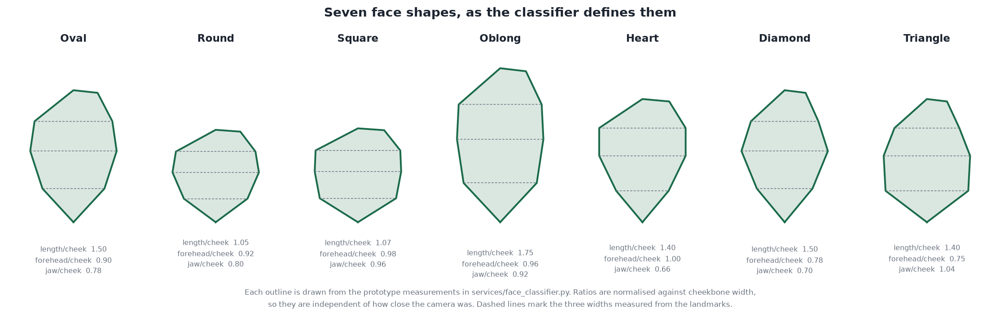
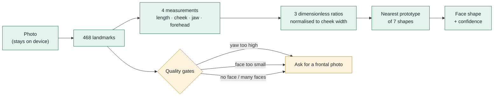
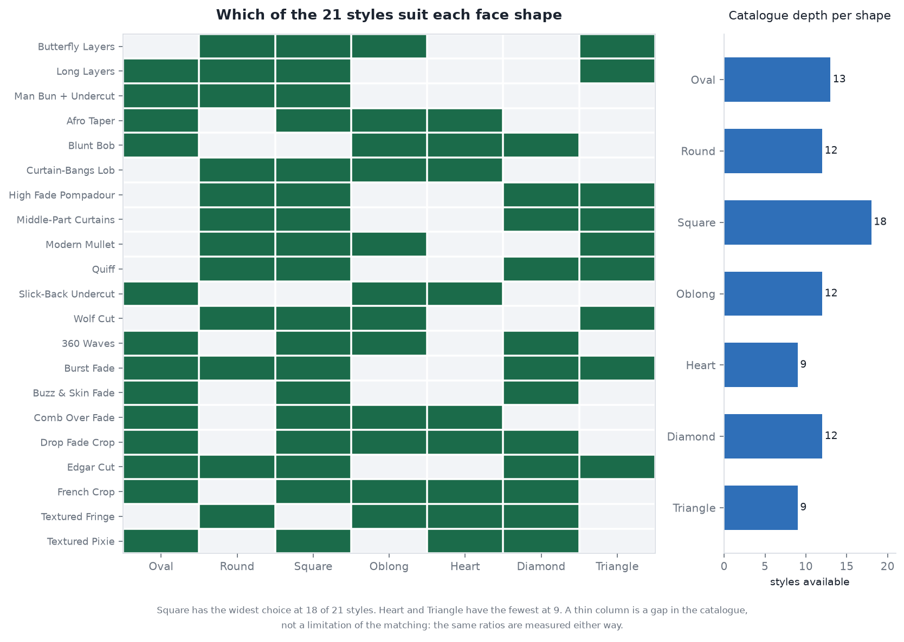
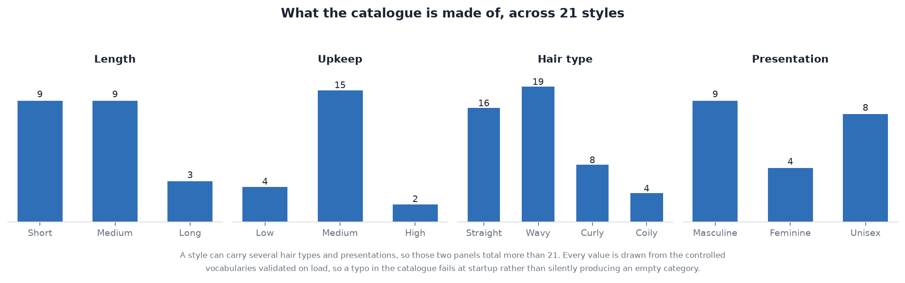
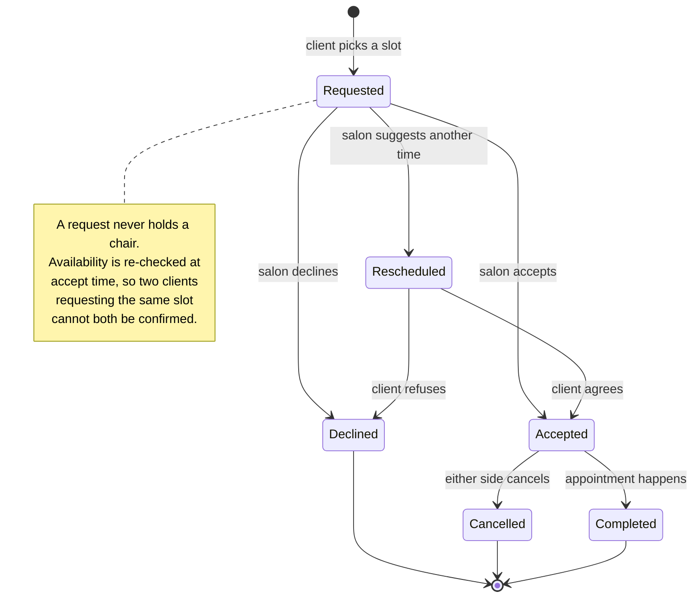
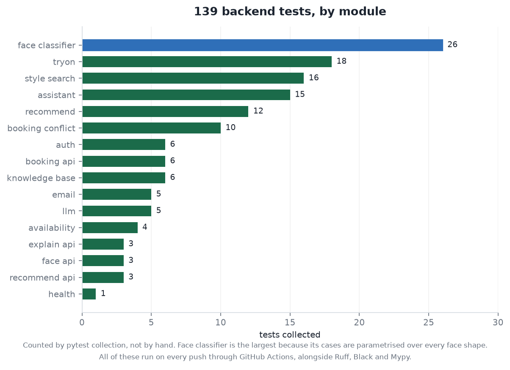

<div align="center">

# CutPoint

**Face shape analysis, hairstyle recommendation and salon booking.**

Upload a photo, get your face shape from facial geometry, see styles that suit it from four angles,
try one on your own photo, then find a nearby salon and book.

[](https://www.python.org/)
[](https://fastapi.tiangolo.com/)
[](https://nextjs.org/)
[](https://www.typescriptlang.org/)
[](https://www.postgresql.org/)
[](#testing)
[](.github/workflows/ci.yml)
[](LICENSE)

</div>

---

## Contents

[What it does](#what-it-does) ·
[Architecture](#architecture) ·
[How the face analysis works](#how-the-face-analysis-works) ·
[The catalogue](#the-catalogue) ·
[Recommendation and search](#recommendation-and-search) ·
[Booking](#booking) ·
[Testing](#testing) ·
[Tech stack](#tech-stack) ·
[Running it locally](#running-it-locally) ·
[Scope and limitations](#scope-and-limitations) ·
[What was hard](#what-was-hard)

---

## What it does

Three things, each usable on its own.

**Face shape and virtual try-on.** Detects face shape from bone structure geometry rather than
hair, so it works on bald and short-haired users. Recommends styles for that shape plus stated
preferences, shows each from four reference angles, and overlays the chosen style on the user's own
photo.

**Catalogue, search and a grounded assistant.** Plain-English search over the style catalogue, where
a query like *"something low maintenance that works with curls"* is parsed into the catalogue's own
vocabulary and used to rank and filter, with the reasons each result matched shown alongside it. A
question box answers only from the knowledge base and shows the entries it used.

**Two-sided salon booking.** Clients find nearby salons, browse rates and request a slot. Salons
accept or decline from a dashboard. Chairs cannot be double booked, by construction and by test.

> **Status:** built and running. Backend, frontend and database all run locally from the steps
> below. Not deployed publicly, because the booking side stores real salon and client records and
> hosting that without a reason to is not worth the risk.

---

## Architecture

Three pieces. A Next.js frontend that does all the face work in the browser, a FastAPI backend
holding the catalogue, the booking logic and the model calls, and PostgreSQL behind it.



The split matters in one place. **Face landmarks never leave the browser.** The backend receives
derived ratios, not a photograph, unless the user explicitly asks for a server-side realistic
try-on, and then it receives only that one image.

---

## How the face analysis works

Face shape is measured, not predicted. Detection uses **geometric ratios over MediaPipe's 468
facial landmarks**: face length, cheekbone width, jaw width, forehead width and the jaw angle.

That choice is deliberate. The ratios are explainable, they need no training data, and because they
measure bone structure rather than hair they stay accurate on bald and short-haired faces, which is
exactly where a hair-trained classifier fails. Every ratio is normalised against cheekbone width,
so the result does not change with how close the camera was.



Each outline above is drawn directly from the prototype measurements in
[`services/face_classifier.py`](backend/app/services/face_classifier.py). A face is classified by
comparing its measured ratios against these seven prototypes.



Quality gates run before classification. A photo taken at an angle, from too far away, with no face
or with several faces is rejected with a specific message rather than silently producing a shape
the geometry cannot support.

---

## The catalogue

21 styles described in a validated YAML file with controlled vocabularies. A typo fails at startup
rather than quietly producing an empty category.



The matrix above is generated from
[`knowledge/hairstyles.yaml`](backend/app/knowledge/hairstyles.yaml), not drawn by hand. The thin
columns are worth reading honestly: a shape with fewer options has a gap in the catalogue, not a
weakness in the matching, because the same ratios are measured either way.



Each style carries its presentation, length, hair types, upkeep level, the face shapes it flatters,
and rationale tags that drive the written explanation of *why* it was suggested.

---

## Recommendation and search

**Ranking** scores each style against the detected face shape and the stated preferences, and
reports which preferences it satisfied. Nothing is a black box: every result carries its reasons.

**Natural-language search** turns a free-text query into those same controlled vocabularies. A
language model does the parsing when a key is configured, because it handles phrasings no keyword
table will cover, and anything it returns outside the vocabulary is **discarded rather than
trusted**. Retrieval itself is a TF-IDF index built over the catalogue at startup. A corpus of 21
documents does not need a vector database, and an in-process index keeps the feature deployable
with no extra service.

**The assistant** answers questions by retrieving the most relevant entries and giving the model
those entries and nothing else. The entries used are returned with the answer and shown in the UI.
That is the difference between a chatbot and a product feature: the answer can be checked.

Every model call has a deterministic fallback and swallows its own failures, so a missing key, a
rate limit or a withdrawn model degrades the experience rather than breaking it. **The whole app
works with no API keys at all.**

---

## Booking

Two sided, and conflict-free by construction.



Clients can attach a saved look to a request. Salons see revenue, upcoming and completed
appointments and their client list. Email notifications fire on request and on accept or decline,
and no-op cleanly when no credentials are set.

---

## Testing



Counted by pytest collection, not by hand. The face classifier is the largest group because its
cases are parametrised over every face shape. All of them run on every push and pull request
through [GitHub Actions](.github/workflows/ci.yml), alongside Ruff, Black and Mypy on the backend
and lint plus build on the frontend. A change that breaks any of them does not reach `main`.

```bash
cd backend && pytest                                      # 139 tests
ruff check app tests && black --check app tests && mypy app
cd frontend && npx eslint app components lib && npm run build
```

---

## Tech stack

| Layer | Choice | Why |
| --- | --- | --- |
| Frontend | Next.js 16 (App Router), TypeScript, Tailwind v4 | Modern React, type-safe, fast UI |
| Computer vision | MediaPipe Tasks Vision, in-browser | Heavy CV runs on the user's device, so no ML server cost |
| 2D try-on | HTML Canvas | Landmark-anchored overlay and PNG export |
| Backend | FastAPI, Pydantic v2, SQLModel, Alembic | Typed, migration-managed API |
| LLM | Groq (`openai/gpt-oss-120b`) | Sub-second inference; every call has a deterministic fallback |
| Retrieval | In-process TF-IDF over the catalogue | 21 documents; a vector DB would be weight without benefit |
| Realistic try-on | Cloudflare Workers AI inpainting, fal.ai optional | Cloudflare is free and inpaints the hair region only |
| 3D avatar | Ready Player Me + `<model-viewer>` *(optional)* | Selfie to 3D avatar showcase |
| Email | Gmail SMTP, background tasks | Request and accept/decline notifications; no-op without creds |
| Database | PostgreSQL, Docker locally | Relational integrity for bookings |
| Auth | Self-hosted JWT + bcrypt, two roles | No external dependency |

---

## Running it locally

Prerequisites: **Node 18+**, **Python 3.11+**, **Docker** (for Postgres), **Git**.

```bash
git clone https://github.com/Ramdas-Chaugale/the-cut-point.git && cd the-cut-point

cp .env.example .env
docker compose up -d                  # Postgres with a health check and a named volume

cd backend
python -m venv .venv
# Windows: .venv\Scripts\activate   |   macOS/Linux: source .venv/bin/activate
pip install -r requirements-dev.txt
cp ../.env.example .env
uvicorn app.main:app --reload         # http://localhost:8000, docs at /docs

cd ../frontend                        # new terminal
npm install
echo "NEXT_PUBLIC_API_BASE_URL=http://localhost:8000" > .env.local
npm run dev                           # http://localhost:3000
```

The landing page shows a live API status badge confirming the frontend and backend are talking.

Regenerating the figures in this README:

```bash
python tools/make_readme_figures.py   # reads the catalogue, classifier and pytest collection
```

<details>
<summary><b>Project structure</b></summary>

```
the_cut_point/
├─ frontend/              # Next.js app (UI, MediaPipe, try-on canvas)
│  ├─ app/                # routes, including /styles catalogue and search
│  ├─ components/         # UI components
│  ├─ lib/                # api client, geometry, mediapipe helpers
│  └─ public/assets/hair/ # per-style reference renders, four angles each
├─ backend/               # FastAPI app
│  ├─ app/
│  │  ├─ api/             # routers: recommend, search, booking, auth, tryon
│  │  ├─ core/            # config, db
│  │  ├─ models/          # SQLModel entities and API schemas
│  │  ├─ services/        # face geometry, classifier, recommend, search, llm
│  │  └─ knowledge/       # the validated style catalogue
│  ├─ alembic/            # migrations, versioned with the code
│  └─ tests/              # 139 tests
├─ tools/                 # asset and figure generators
├─ docs/figures/          # the charts in this README, generated from repo data
├─ docker-compose.yml     # local Postgres
└─ .github/workflows/     # CI
```

</details>

---

## Scope and limitations

Stated plainly, because a portfolio project that overstates itself is worth less than one that does
not.

- The 2D try-on is a **landmark-anchored overlay, not a neural render**.
- The four-angle views are **reference images of each hairstyle**, not a reconstruction of the
  user's own head. A single front photo cannot give a real back-of-head view, so the app does not
  invent one.
- The realistic AI try-on and the 3D avatar are **optional, provider-backed add-ons**. The core app
  is fully functional without them.
- A single primary face is assumed, with specific messaging for no face, multiple faces, low
  quality and non-frontal photos.
- Face shape prototypes are anthropometric reference values, not a population study. They classify
  consistently; they are not a clinical measurement.

---

## What was hard

**Anchoring the overlay.** The first version pinned the hairstyle to the top of the head and it sat
over the face. Anchoring to the two cheekbone landmarks instead, and solving a similarity transform
between those and two fixed points in the artwork, puts it where hair actually sits.

**Knowing when a result is not worth showing.** The realistic try-on costs real inference time, so
the UI has to say what it is doing and let the user fall back to the instant overlay. A feature that
takes six seconds without saying so reads as broken.

**Keeping the language model optional.** Every model call has a deterministic fallback, which meant
writing each feature twice. It is why the app still works with no API keys at all.

---

<div align="center">

Designed and built by **[Ramdas Chaugale](https://github.com/Ramdas-Chaugale)** as an individual
project.

Licensed under the [MIT License](LICENSE). Copyright 2026 Ramdas Chaugale.

</div>
