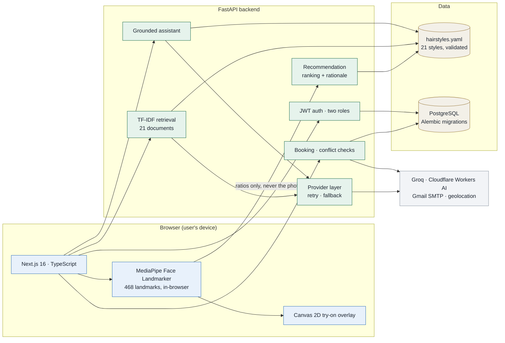
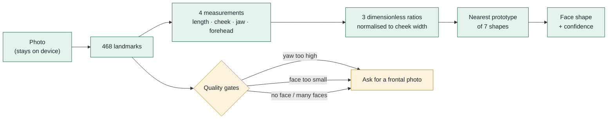
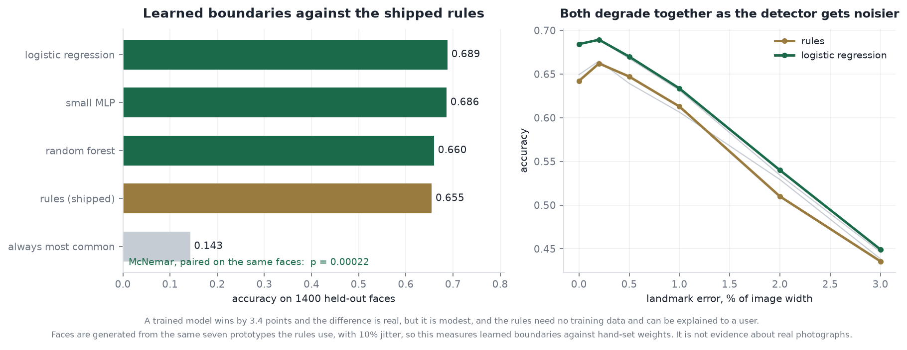
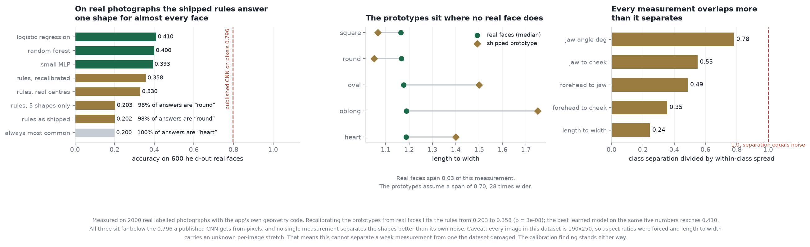
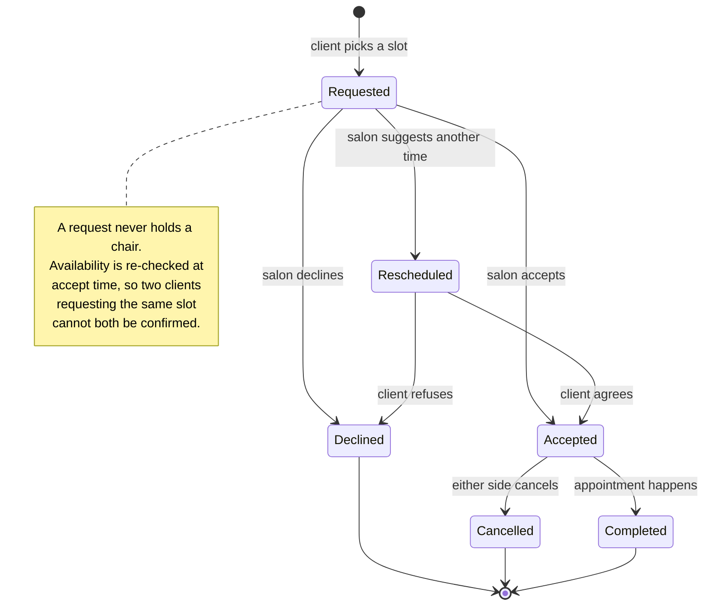

<div align="center">

# CutPoint

**Face shape analysis, hairstyle recommendation and salon booking.**

Upload a photo, get your face shape from facial geometry, see styles that suit it from four angles,
try one on your own photo, then find a nearby salon and book.

[](https://www.python.org/)
[](https://fastapi.tiangolo.com/)
[](https://nextjs.org/)
[](https://www.typescriptlang.org/)
[](https://www.postgresql.org/)
[](#testing)
[](.github/workflows/ci.yml)
[](LICENSE)

</div>

---

## Contents

[What it does](#what-it-does) ·
[Architecture](#architecture) ·
[How the face analysis works](#how-the-face-analysis-works) ·
[The catalogue](#the-catalogue) ·
[Recommendation and search](#recommendation-and-search) ·
[Booking](#booking) ·
[Testing](#testing) ·
[Tech stack](#tech-stack) ·
[Running it locally](#running-it-locally) ·
[Scope and limitations](#scope-and-limitations) ·
[What was hard](#what-was-hard)

---

## What it does

Three things, each usable on its own.

**Face shape and virtual try-on.** Detects face shape from bone structure geometry rather than
hair, so it works on bald and short-haired users. Recommends styles for that shape plus stated
preferences, shows each from four reference angles, and overlays the chosen style on the user's own
photo.

**Catalogue, search and a grounded assistant.** Plain-English search over the style catalogue, where
a query like *"something low maintenance that works with curls"* is parsed into the catalogue's own
vocabulary and used to rank and filter, with the reasons each result matched shown alongside it. A
question box answers only from the knowledge base and shows the entries it used.

**Two-sided salon booking.** Clients find nearby salons, browse rates and request a slot. Salons
accept or decline from a dashboard. Chairs cannot be double booked, by construction and by test.

> **Status:** built and running. Backend, frontend and database all run locally from the steps
> below. Not deployed publicly, because the booking side stores real salon and client records and
> hosting that without a reason to is not worth the risk.

---

## Architecture

Three pieces. A Next.js frontend that does all the face work in the browser, a FastAPI backend
holding the catalogue, the booking logic and the model calls, and PostgreSQL behind it.



The split matters in one place. **Face landmarks never leave the browser.** The backend receives
derived ratios, not a photograph, unless the user explicitly asks for a server-side realistic
try-on, and then it receives only that one image.

---

## How the face analysis works

Face shape is measured, not predicted. Detection uses **geometric ratios over MediaPipe's 468
facial landmarks**: face length, cheekbone width, jaw width, forehead width and the jaw angle.

That choice is deliberate. The ratios are explainable, they need no training data, and because they
measure bone structure rather than hair they stay accurate on bald and short-haired faces, which is
exactly where a hair-trained classifier fails. Every ratio is normalised against cheekbone width,
so the result does not change with how close the camera was.


Each outline above is drawn directly from the prototype measurements in
[`services/face_classifier.py`](backend/app/services/face_classifier.py). A face is classified by
comparing its measured ratios against these seven prototypes.



Quality gates run before classification. A photo taken at an angle, from too far away, with no face
or with several faces is rejected with a specific message rather than silently producing a shape
the geometry cannot support.

---

## Would a trained model do better?

The classifier above is rule based: measure the ratios, compare against seven
prototypes with hand-set weights, take the nearest. That is a design decision,
and a design decision deserves testing rather than asserting.

So the rules were put against trained models on the same held-out faces.



| | Accuracy | |
|---|---|---|
| Logistic regression | **0.689** | trained |
| Small MLP | 0.686 | trained |
| Random forest | 0.660 | trained |
| **Rules, as shipped** | **0.655** | no training |
| Always guess the commonest | 0.143 | floor |

**A trained model does win, by 3.4 points, and the difference is real.**
McNemar's test paired on the same faces gives p = 0.0002, with 101 cases where
the model is right and the rules wrong against 54 the other way.

It is also modest. The rules need no training data, can be explained to a user
in one sentence, and degrade at the same rate as the learned model when the
landmark detector gets noisier.

**What this does not show.** The faces are generated from the same seven
prototypes the rules use, with 10% jitter. So it measures whether learned
boundaries beat hand-set weights on that distribution. It is **not** evidence
about real photographs. That limit is written into the results file too, and
the next section is what happened when real photographs were finally measured.

```bash
python experiments/face_classifier_study.py     # -> results/face_classifier_study.json
python experiments/make_classifier_figures.py   # -> the figure above
```

---

## What happened on real photographs

The study above could not say anything about real faces. This one can. It takes
2000 labelled photographs, measures every one with the app's own geometry code,
and scores the shipped rules against them.

The result is not flattering, which is why it is here.



| On 600 held-out real faces | Accuracy | |
|---|---|---|
| Logistic regression | **0.410** | trained on the same five numbers |
| Random forest | 0.400 | trained |
| Small MLP | 0.393 | trained |
| Rules, prototypes and scales recalibrated | 0.358 | no training at inference |
| Rules, prototypes recalibrated | 0.330 | no training at inference |
| **Rules, as shipped** | **0.203** | answers "round" 98% of the time |
| Always guess the commonest | 0.200 | floor |

**The shipped rules do no better than guessing.** 0.203 against a 0.200 floor,
and they answer "round" for 98 faces out of 100. On real photographs the
classifier has collapsed onto one shape.

### Why

The prototypes were set by hand and they sit where no real face sits. A real
face measures between 1.16 and 1.19 on length to width. The prototypes assume
that number ranges from 1.05 to 1.75, a span 28 times wider than reality. Every
per-feature scale is 3 to 7 times too wide as well. So almost every real face
lands nearest the same prototype and the rule has nothing left to separate.

That part is a bug, and fixing it helps. Rebuilding the prototypes from real
faces and rescaling to the real spread takes the same rule from 0.203 to 0.358
(McNemar p = 3e-08).

### The harder finding

Fixing the calibration is not enough. The best trained model on the same five
measurements reaches 0.410, and a published CNN reading pixels on a version of
this dataset reaches 0.796.

The reason shows in the third panel. For every one of the five measurements, the
spread *within* a shape is larger than the spread *between* shapes. Jaw angle is
the best of them at 0.78 and still below 1.0. Length to width, the measurement
the whole idea rests on, is the worst at 0.24: heart measures 1.187 and square
measures 1.165, and individual faces vary far more than that gap.

Five bone-structure ratios are not enough to tell these five shapes apart.

### The caveat that stops this going further

Every image in this dataset is exactly 190x250 pixels. The aspect ratios were
forced, so each photograph carries an unknown horizontal stretch, and that lands
hardest on length to width. So this cannot cleanly separate a measurement that is
genuinely weak from one this dataset damaged. Settling that needs a dataset with
the original framing kept.

The calibration finding holds either way, because the prototypes are wrong by
far more than any crop could explain.

### What was changed, and what was not

**Nothing was shipped from this.** The recalibrated prototypes are better on this
dataset, but they were derived from images with the aspect ratios already broken,
so putting them into production would trade a known bug for an unmeasured one.
They stay in the results file until there is a dataset worth trusting.

What it does change is the claim. A face shape returned with a confidence score
implies a precision these measurements do not have, so that is the part to fix
first, and it is a product decision rather than a modelling one.

```bash
python experiments/real_face_features.py --per-class 400  # downloads, measures
python experiments/real_face_study.py                     # the table above
python experiments/make_real_study_figures.py             # the figure above
```

The photographs are of real people and are not redistributed here. The scripts
download them to `.cache/`, which is git-ignored, and only the derived
measurements are committed.

---

## The catalogue

21 styles described in a validated YAML file with controlled vocabularies. A typo fails at startup
rather than quietly producing an empty category.


The matrix above is generated from
[`knowledge/hairstyles.yaml`](backend/app/knowledge/hairstyles.yaml), not drawn by hand. The thin
columns are worth reading honestly: a shape with fewer options has a gap in the catalogue, not a
weakness in the matching, because the same ratios are measured either way.


Each style carries its presentation, length, hair types, upkeep level, the face shapes it flatters,
and rationale tags that drive the written explanation of *why* it was suggested.

---

## Recommendation and search

**Ranking** scores each style against the detected face shape and the stated preferences, and
reports which preferences it satisfied. Nothing is a black box: every result carries its reasons.

**Natural-language search** turns a free-text query into those same controlled vocabularies. A
language model does the parsing when a key is configured, because it handles phrasings no keyword
table will cover, and anything it returns outside the vocabulary is **discarded rather than
trusted**. Retrieval itself is a TF-IDF index built over the catalogue at startup. A corpus of 21
documents does not need a vector database, and an in-process index keeps the feature deployable
with no extra service.

**The assistant** answers questions by retrieving the most relevant entries and giving the model
those entries and nothing else. The entries used are returned with the answer and shown in the UI.
That is the difference between a chatbot and a product feature: the answer can be checked.

Every model call has a deterministic fallback and swallows its own failures, so a missing key, a
rate limit or a withdrawn model degrades the experience rather than breaking it. **The whole app
works with no API keys at all.**

---

## Booking

Two sided, and conflict-free by construction.



Clients can attach a saved look to a request. Salons see revenue, upcoming and completed
appointments and their client list. Email notifications fire on request and on accept or decline,
and no-op cleanly when no credentials are set.

---

## Testing


Counted by pytest collection, not by hand. The face classifier is the largest group because its
cases are parametrised over every face shape. All of them run on every push and pull request
through [GitHub Actions](.github/workflows/ci.yml), alongside Ruff, Black and Mypy on the backend
and lint plus build on the frontend. A change that breaks any of them does not reach `main`.

```bash
cd backend && pytest                                      # 139 tests
ruff check app tests && black --check app tests && mypy app
cd frontend && npx eslint app components lib && npm run build
```

---

## Tech stack

| Layer | Choice | Why |
| --- | --- | --- |
| Frontend | Next.js 16 (App Router), TypeScript, Tailwind v4 | Modern React, type-safe, fast UI |
| Computer vision | MediaPipe Tasks Vision, in-browser | Heavy CV runs on the user's device, so no ML server cost |
| 2D try-on | HTML Canvas | Landmark-anchored overlay and PNG export |
| Backend | FastAPI, Pydantic v2, SQLModel, Alembic | Typed, migration-managed API |
| LLM | Groq (`openai/gpt-oss-120b`) | Sub-second inference; every call has a deterministic fallback |
| Retrieval | In-process TF-IDF over the catalogue | 21 documents; a vector DB would be weight without benefit |
| Realistic try-on | Cloudflare Workers AI inpainting, fal.ai optional | Cloudflare is free and inpaints the hair region only |
| 3D avatar | Ready Player Me + `<model-viewer>` *(optional)* | Selfie to 3D avatar showcase |
| Email | Gmail SMTP, background tasks | Request and accept/decline notifications; no-op without creds |
| Database | PostgreSQL, Docker locally | Relational integrity for bookings |
| Auth | Self-hosted JWT + bcrypt, two roles | No external dependency |

---

## Where the numbers come from

Every figure and every claim traces back to a file in the repository. Nothing is
typed into a chart by hand.

| Stage | File | Holds |
|---|---|---|
| **Catalogue** | `backend/app/knowledge/hairstyles.yaml` | 21 styles with controlled vocabularies, validated on load |
| **Geometry** | `services/face_geometry.py` | four measurements, three ratios, normalised to cheekbone width |
| **Classifier** | `services/face_classifier.py` | seven prototype faces and the distance function |
| **Ranking** | `services/recommend.py` | scoring, and the reasons returned with each result |
| **Search** | `services/style_search.py` | TF-IDF index built over the catalogue at startup |
| **Charts** | `tools/make_readme_figures.py` | `docs/figures/*.png`, from the YAML, the classifier and a pytest run |
| **Narrative** | `notebooks/walkthrough.ipynb` | imports from `backend/app`, runs the real classifier |

### The walkthrough notebook

**[`notebooks/walkthrough.ipynb`](notebooks/walkthrough.ipynb)** is the quickest
way to see how this works. It is executed, so outputs and charts render on
GitHub without cloning.

It runs the real classifier **without a single photograph**, because
`build_face_landmarks` turns four measurements into a landmark set. It checks
that all seven prototypes classify as themselves, then morphs a face
continuously from round to oblong and watches confidence dip exactly where the
classifier changes its mind, which is what should happen to a face genuinely on
a boundary. It then runs a real recommendation with its reasons, and measures
how much choice each face shape actually gets from the catalogue.

```bash
python tools/build_walkthrough.py   # regenerates and re-executes it
```

---

## Running it locally

Prerequisites: **Node 18+**, **Python 3.11+**, **Docker** (for Postgres), **Git**.

```bash
git clone https://github.com/Ramdas-Chaugale/the-cut-point.git && cd the-cut-point

cp .env.example .env
docker compose up -d                  # Postgres with a health check and a named volume

cd backend
python -m venv .venv
# Windows: .venv\Scripts\activate   |   macOS/Linux: source .venv/bin/activate
pip install -r requirements-dev.txt
cp ../.env.example .env
uvicorn app.main:app --reload         # http://localhost:8000, docs at /docs

cd ../frontend                        # new terminal
npm install
echo "NEXT_PUBLIC_API_BASE_URL=http://localhost:8000" > .env.local
npm run dev                           # http://localhost:3000
```

The landing page shows a live API status badge confirming the frontend and backend are talking.

Regenerating the figures in this README:

```bash
python tools/make_readme_figures.py   # reads the catalogue, classifier and pytest collection
```

<details>
<summary><b>Project structure</b></summary>

```
the_cut_point/
├─ frontend/              # Next.js app (UI, MediaPipe, try-on canvas)
│  ├─ app/                # routes, including /styles catalogue and search
│  ├─ components/         # UI components
│  ├─ lib/                # api client, geometry, mediapipe helpers
│  └─ public/assets/hair/ # per-style reference renders, four angles each
├─ backend/               # FastAPI app
│  ├─ app/
│  │  ├─ api/             # routers: recommend, search, booking, auth, tryon
│  │  ├─ core/            # config, db
│  │  ├─ models/          # SQLModel entities and API schemas
│  │  ├─ services/        # face geometry, classifier, recommend, search, llm
│  │  └─ knowledge/       # the validated style catalogue
│  ├─ alembic/            # migrations, versioned with the code
│  └─ tests/              # 139 tests
├─ tools/                 # asset, figure and notebook generators
├─ notebooks/             # the walkthrough, executed
├─ docs/figures/          # the charts in this README, generated from repo data
├─ docker-compose.yml     # local Postgres
└─ .github/workflows/     # CI
```

</details>

---

## Scope and limitations

Stated plainly, because a portfolio project that overstates itself is worth less than one that does
not.

- The 2D try-on is a **landmark-anchored overlay, not a neural render**.
- The four-angle views are **reference images of each hairstyle**, not a reconstruction of the
  user's own head. A single front photo cannot give a real back-of-head view, so the app does not
  invent one.
- The realistic AI try-on and the 3D avatar are **optional, provider-backed add-ons**. The core app
  is fully functional without them.
- A single primary face is assumed, with specific messaging for no face, multiple faces, low
  quality and non-frontal photos.
- Face shape prototypes are anthropometric reference values, not a population study. They classify
  consistently; they are not a clinical measurement.

---

## What was hard

**Anchoring the overlay.** The first version pinned the hairstyle to the top of the head and it sat
over the face. Anchoring to the two cheekbone landmarks instead, and solving a similarity transform
between those and two fixed points in the artwork, puts it where hair actually sits.

**Knowing when a result is not worth showing.** The realistic try-on costs real inference time, so
the UI has to say what it is doing and let the user fall back to the instant overlay. A feature that
takes six seconds without saying so reads as broken.

**Keeping the language model optional.** Every model call has a deterministic fallback, which meant
writing each feature twice. It is why the app still works with no API keys at all.

---

<div align="center">

Designed and built by **[Ramdas Chaugale](https://github.com/Ramdas-Chaugale)** as an individual
project.

Licensed under the [MIT License](LICENSE). Copyright 2026 Ramdas Chaugale.

</div>
